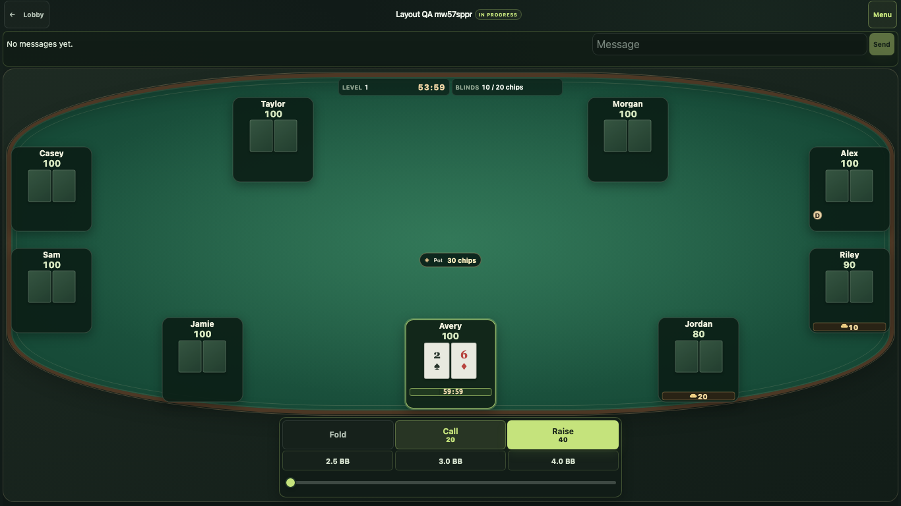

# Felt Night

Felt Night is a self-hosted, play-chip No-Limit Texas Hold’em room for private sit-and-go games. It uses Python 3.9+, the standard library, and SQLite.



Players create private accounts, return to a seat after reconnecting, and review tournament results and hand histories. Hosts can run 2–9 player freezeouts with configurable stacks, blinds, blind levels, clocks, buy-ins, and payouts. The server validates actions and keeps the deck and opponents’ hidden cards private. Play credits have no cash value; there are no deposits, cash-outs, prizes, or rebuys.

New game opens a lobby and its single host setup dialog. Hosts choose the game name, buy-in, starting stack, blinds, blind-level duration, shot clock, and payout shares. Payout sliders keep the total at 100%; the occupied seats determine the field size when the host starts. Hosts can pause/resume play and end a game with two confirmations. Ending early preserves the game record without declaring a winner or inventing a payout.

The table uses a dedicated gameplay view with a seat ring, centered board and pot, and betting controls below the felt. Chat, history, replay, and host controls are available from the table menu. The settings dialog keeps its close control reachable on mobile. Fullscreen and a separate table window are optional, and the mobile web app can be installed in standalone mode. Live game requests always require the server; the app does not offer offline play.

A separate, explicitly enabled room admin configures shared preflop/postflop bet presets, all-in street delay, blind/elimination announcements, and showdown result holds. Admin changes apply to future pacing transitions without resetting an active deadline. Only admin can add or remove test bots. The admin account cannot create a game, take a seat, or submit poker actions. Normal players retain their personal accounts, reconnectable seats, and private tournament histories.

Sit-out persists until switched off and immediately checks when free or folds facing a bet. Blind levels change only between hands. Buy-ins, payouts, starting stacks, and blind amounts stay locked after play begins. The completed table keeps the final board and participants visible; the last-hand viewer steps through each street and shows winners and exposed hand ranks. Chip counts can toggle to big blinds.

Bots use an adapted [PokerForBots complex strategy](https://github.com/lox/pokerforbots/tree/main/sdk/bots/complex): position ranges, hand and draw categories, pot odds, and stack-aware sizing. Decisions use only the bot’s own cards and public information; no service or model calls are involved. See [third-party notices](THIRD_PARTY_NOTICES.md) for attribution.

A modified browser cannot choose cards or bypass server rules, but no online room can prevent collusion, shared credentials, or dishonest operation. Felt Night has no public shuffle proof or independent fairness certification. See the [fair play and security guide](static/security.html).

## Run locally

Clone the repository and check that Python is 3.9 or newer:

```sh
git clone https://github.com/moey823/felt-night.git felt-night
cd felt-night
python3 --version
```

Create a private invite file and an external data directory. The file must contain one UTF-8 line and be readable only by the account running the server:

```sh
mkdir -p "$HOME/.config/felt-night" "$HOME/.local/share/felt-night/data"
chmod 700 "$HOME/.config/felt-night" "$HOME/.local/share/felt-night" "$HOME/.local/share/felt-night/data"
umask 077
vi "$HOME/.config/felt-night/room-invite"
chmod 600 "$HOME/.config/felt-night/room-invite"
```

Start the room on loopback, then open <http://localhost:18943/poker/>:

```sh
FELT_NIGHT_ROOM_PASSWORD_FILE="$HOME/.config/felt-night/room-invite" python3 server.py --host 127.0.0.1 --port 18943 --public-origin http://localhost:18943 --data-dir "$HOME/.local/share/felt-night/data"
```

Normal startup requires exactly one of `FELT_NIGHT_ROOM_PASSWORD_FILE` or `FELT_NIGHT_ROOM_PASSWORD`. The file setting is recommended: use a regular file owned by the service account with mode `0600`; group and other permission bits are rejected. One trailing newline is accepted. The direct environment value is an alternative, but do not commit it or put it in a shared shell profile. Do not set both. The SQLite database stays under the external data directory at `sitngo.sqlite3`.

Changing the room invite and restarting invalidates existing sessions. Player accounts and tournament history remain in the database. For a public HTTPS setup, see the [Linux systemd and Caddy examples](deploy/README.md). Tailscale is optional; the app has no Tailscale runtime dependency.

## Private-room admin

Set `FELT_NIGHT_ADMIN_USERNAME=admin` only behind a trusted private network such as tailnet-only Tailscale Serve. Sign in as `admin` with an empty password. This is a configuration account, not a player account. Leave the variable unset on a public deployment; do not enable it through Tailscale Funnel. An existing player account with the configured admin username causes startup to fail rather than changing that player's permissions.

Global configuration is stored with the room database. Normal players cannot change it. Removing the environment setting disables admin access and revokes its sessions.

Admins can open **Past games** to inspect completed, ended, cancelled, and expired games, including saved hands. Deleting a game requires an explicit confirmation and permanently removes that game's table, chat, and saved history; player accounts and sessions remain.

## Tests

Run `python3 -m unittest discover -s tests` for the engine, authentication, permissions, persistence, and HTTP contracts. Browser tests use isolated data, a dummy invite, and a test-only enabled admin:

```sh
BROWSER_BIN=/path/to/chrome-headless-shell node tests/browser/run.mjs
BROWSER_BIN=/path/to/chrome-headless-shell node tests/browser/run.mjs flow
BROWSER_BIN=/path/to/chrome-headless-shell node tests/browser/run.mjs layout
BROWSER_BIN=/path/to/chrome-headless-shell node tests/browser/run.mjs compact
BROWSER_BIN=/path/to/chrome-headless-shell node tests/browser/run.mjs stability
```

Set `QA_SCREEN_DIR` to a directory on the development machine to retain screenshots. The default suite plays real hands and checks action submission, reconnects, and history. The flow suite covers host setup, payouts, admin separation, mobile dialogs, and ending a game. The layout suite checks crowded tables across screen sizes. The stability suite checks a nine-player game, timer pause/resume, compact chat, viewport controls, seat markers, winner badges, and the admin past-game flow. See [the design and verification priorities](docs/ux-design.md).

## License

Released under the [MIT License](LICENSE).
